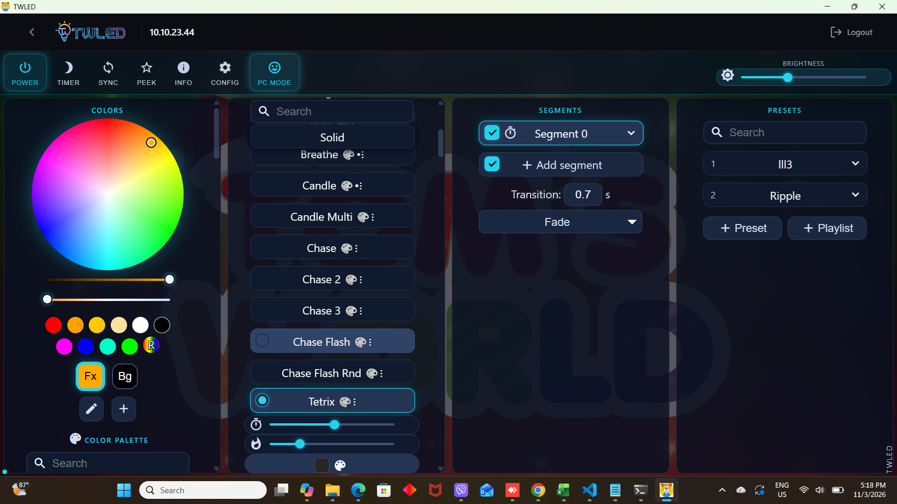
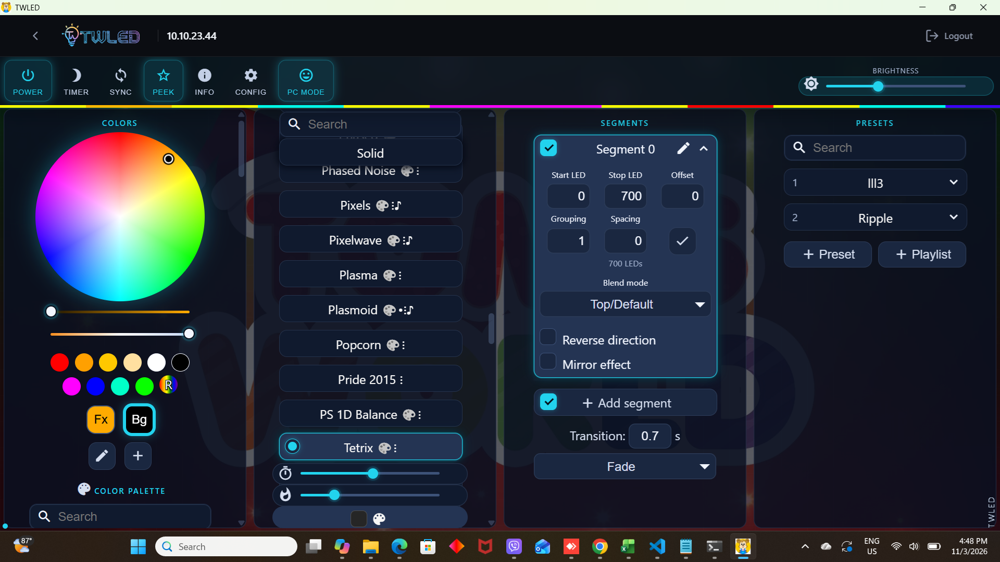

# 🌈 TWLED/WLED-GUI

## 👋 About this project
This is a cross-platform desktop app for [TWLED/WLED](https://github.com/Aircoookie/WLED). You can use it on Windows, Linux and MAC.

## ⚙️ Features
- Looks similar to the TWLED/WLED app for android/ios ✅
- Cross-platform ✅
- Multiple TWLED/WLEDs support ✅
- Automatically turn on lights at system startup ✅

## 🖼️ Images

 
## ⬇️ Download
You can download the latest version [here](https://github.com/Lexyl1225/TWLED-GUI/releases/latest).

## ✌️ Credits
- [Akemi](https://github.com/Aircoookie/Akemi)
- [auto-launch](https://www.npmjs.com/package/auto-launch)
- [bonjour](https://www.npmjs.com/package/bonjour)
- [Electron](https://www.electronjs.org/)
- [electron-builder](https://github.com/electron-userland/electron-builder)
- [electron-log](https://www.npmjs.com/package/electron-log)
- [NodeJS](https://nodejs.org/)
- [Original Author](https://github.com/w00000dy/WLED-GUI)